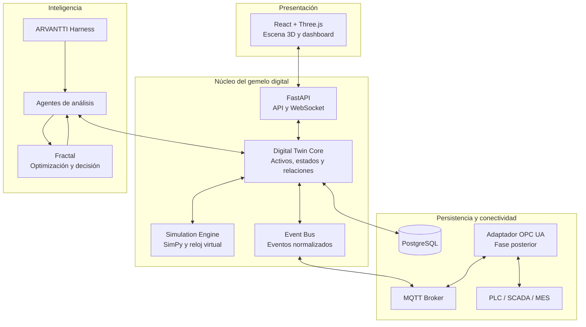
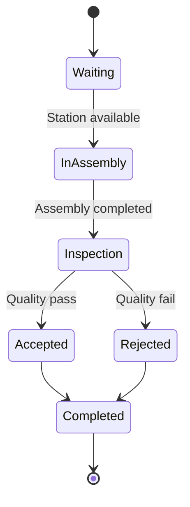

# ARVANTTI Harness — Industrial Digital Twin

**Documento de arquitectura y plan de implementación**  
**Versión:** 0.1.0 · **Estado:** Propuesta técnica  
**Plataforma objetivo:** Web interactiva en navegador · Fedora/Linux  
**Sector inicial:** Fábricas y celdas de montaje  
**Estrategia de datos:** Simulación sintética inicial, conectividad industrial posterior

---

## 1. Resumen ejecutivo

La propuesta consiste en desarrollar un **gemelo digital industrial como capacidad instalable de ARVANTTI Harness**, comenzando por una celda de montaje automatizada con visualización 3D realista, simulación de producción, telemetría y paneles de operación.

La arquitectura debe evolucionar desde una simulación sintética hasta la conexión con PLC, SCADA, sensores y sistemas empresariales sin rehacer el producto.

La decisión central es separar:

1. El motor de visualización 3D.
2. El modelo lógico del proceso industrial.
3. El motor de simulación.
4. La persistencia y los flujos de datos.
5. Los conectores industriales.
6. La inteligencia y optimización.
7. El mecanismo de instalación y permisos de ARVANTTI Harness.

Esta separación permite cambiar el motor gráfico, incorporar protocolos y reutilizar el núcleo en distintas instalaciones sin duplicar la lógica industrial.

## 2. Objetivos y alcance del MVP

### Incluido

- Una celda de montaje 3D con estaciones, transportadores, robot, protecciones e iluminación industrial.
- Navegación orbital y selección de activos.
- Materiales PBR, sombras, cámaras y modelos de alta calidad visual.
- Simulación de piezas, ciclos, recursos, colas, bloqueos y fallos simulados.
- Estados operativos y eventos normalizados.
- Dashboard de producción, tiempos de ciclo, alarmas e historial.
- API y comunicación en tiempo real.
- Persistencia de activos, configuración y resultados.
- Instalación reproducible mediante una capacidad de ARVANTTI Harness.
- Pruebas automatizadas y documentación.

### Fuera del primer MVP

- Escritura hacia PLC o control físico de máquinas.
- Simulación física de precisión industrial o dinámica robótica avanzada.
- Representación completa de una fábrica de gran escala.
- Dependencia obligatoria de servicios en la nube.
- Optimización autónoma que ejecute acciones sobre la planta.

El MVP debe identificarse explícitamente como simulación cuando los datos no provengan de una instalación física.

## 3. Stack tecnológico propuesto

| Componente | Tecnología | Responsabilidad |
|---|---|---|
| Frontend | React + TypeScript + Vite | Aplicación web |
| Renderizado 3D | Three.js + React Three Fiber | Escena 3D interactiva |
| Modelos 3D | glTF/GLB + materiales PBR | Activos visuales |
| API | Python + FastAPI | Servicios y contratos |
| Comunicación en tiempo real | WebSocket | Actualización de escena y paneles |
| Simulación | Python + SimPy | Procesos discretos, recursos y colas |
| Persistencia | PostgreSQL | Activos, configuración, eventos y resultados |
| Mensajería | MQTT + Eclipse Mosquitto | Transporte de telemetría |
| Integración industrial posterior | OPC UA | Lectura de variables industriales |
| Contenedores | Podman + herramienta compatible con Compose | Ejecución y despliegue |
| Pruebas backend | pytest | Núcleo, API y simulación |
| Pruebas frontend | Vitest | Componentes y lógica de interfaz |
| Pruebas end-to-end | Playwright | Flujos completos en navegador |
| Integración continua | GitHub Actions | Validación y construcción |

### Criterios del stack

- **Three.js:** visualización 3D en navegador sin exigir cliente nativo.
- **React Three Fiber:** composición de la escena desde React; mantener el núcleo industrial independiente de esta capa.
- **SimPy:** simulación de eventos discretos. No sustituye un simulador de dinámica robótica o física.
- **FastAPI:** separa la API y el modelo industrial de la interfaz.
- **PostgreSQL:** suficiente para el alcance inicial; evaluar TimescaleDB solo si el volumen de series temporales lo justifica.
- **Podman:** despliegue alineado con Linux y sin dependencia de Docker Desktop.
- **Blender:** preparación y optimización de activos 3D.

El realismo dependerá especialmente de la geometría, los materiales, la iluminación, las cámaras y la optimización de los activos. No se obtiene únicamente añadiendo frameworks.

## 4. Arquitectura lógica



Las conexiones representan flujos lógicos que deberán concretarse en contratos y permisos. En particular, la conexión futura con PLC debe estar separada de la interfaz web y de los agentes.

### 4.1 Digital Twin Core

Mantiene la representación lógica de la instalación:

- Activos y jerarquías.
- Ubicación y relaciones espaciales.
- Variables, estados y unidades.
- Procedencia y calidad de los datos.
- Transiciones de estado.
- Historial de eventos.

Cada activo tiene un identificador estable, independiente del nombre visible y del objeto gráfico.

### 4.2 3D Scene Renderer

Convierte la descripción de la instalación en una escena gráfica. Asocia los identificadores de activos con modelos, animaciones, materiales, cámaras y controles.

El renderer **no es la fuente de verdad** de los estados industriales.

### 4.3 Simulation Engine

Ejecuta el proceso industrial y emite eventos como:

- Pieza creada.
- Estación ocupada.
- Ciclo completado.
- Pieza aceptada o rechazada.
- Equipo bloqueado.
- Fallo simulado.
- Producción completada.

Debe permitir pausa, reinicio, avance controlado y aceleración del tiempo virtual.

### 4.4 Industrial Connectors

Normaliza telemetría procedente de simuladores, MQTT, OPC UA y sistemas empresariales. Cada adaptador implementa un contrato común para impedir que los protocolos contaminen el núcleo.

### 4.5 Operations Dashboard

Presenta:

- Estado de las estaciones.
- Producción por intervalo.
- Tiempos de ciclo.
- Utilización y bloqueos.
- Alarmas e historial de eventos.
- Selección contextual de activos.
- Calidad y antigüedad de los datos.

### 4.6 Intelligence Adapter

Expone herramientas controladas para que ARVANTTI Harness consulte el estado del gemelo, analice anomalías y solicite escenarios. Fractal puede recibir problemas de optimización estructurados y devolver resultados verificables.

La inteligencia no debe tener acceso arbitrario a la red industrial ni autoridad implícita para controlar equipos.

## 5. Contrato de datos de un activo

Ejemplo ilustrativo:

```json
{
  "id": "station-assembly-01",
  "type": "assembly_station",
  "name": "Estacion de montaje 01",
  "parent_id": "cell-01",
  "geometry": {
    "asset_uri": "assets/assembly-station.glb",
    "scale": [1, 1, 1]
  },
  "state": {
    "operating_mode": "running",
    "cycle_time_ms": 42000,
    "quality": "simulated"
  },
  "telemetry": {
    "cycle_count": 128,
    "fault_code": null
  }
}
```

En la implementación, validar el contrato con JSON Schema o modelos Pydantic. Añadir:

- Unidades físicas explícitas.
- Marcas de tiempo.
- Fuente del dato.
- Calidad y frescura.
- Versión del esquema.
- Distinción entre valores observados, calculados y simulados.

Estados iniciales propuestos:

- `idle`
- `running`
- `blocked`
- `fault`
- `maintenance`

Las transiciones deben estar definidas y validadas. La interfaz debe indicar cuando un dato está desactualizado o no disponible, en lugar de presentar un valor antiguo como si fuese actual.

## 6. Arquitectura de paquetes instalables

Los siguientes nombres son identificadores propuestos; deben adaptarse al sistema real de registro, instalación y ejecución de ARVANTTI Harness.

| Paquete | Obligatorio | Responsabilidad |
|---|---:|---|
| `industrial-twin-core` | Sí | Activos, estados, relaciones y eventos |
| `industrial-twin-web3d` | Sí para interfaz | Renderer, escenas, selección y animación |
| `industrial-twin-simulation` | Sí para MVP | Simulación discreta y escenarios |
| `industrial-twin-telemetry` | Sí | Eventos, calidad de datos y suscripciones |
| `industrial-twin-mqtt` | Opcional | Adaptador MQTT |
| `industrial-twin-opcua` | Futuro | Lectura mediante OPC UA |
| `industrial-twin-intelligence` | Opcional | Herramientas para Harness y Fractal |

### 6.1 Manifiesto de instalación propuesto

```yaml
apiVersion: arvantti.tech/v1
kind: Capability
metadata:
  id: industrial-digital-twin
  version: 0.1.0

spec:
  displayName: Industrial Digital Twin
  category: industrial-systems

  runtime:
    os: [linux]
    architecture: [x86_64, aarch64]
    containerEngine: podman

  packages:
    required:
      - industrial-twin-core
      - industrial-twin-web3d
      - industrial-twin-simulation
      - industrial-twin-telemetry
    optional:
      - industrial-twin-mqtt
      - industrial-twin-opcua
      - industrial-twin-intelligence

  services:
    - api
    - web
    - simulation
    - database

  permissions:
    - twin.read
    - simulation.control
    - telemetry.read

  defaults:
    dataSource: simulated
    externalControl: disabled
```

Este manifiesto es una propuesta de contrato, no un formato confirmado de Harness. Antes de implementarlo, hay que mapearlo al esquema real de capacidades, dependencias, permisos y ciclo de vida.

### 6.2 Principios de instalación

- El núcleo debe funcionar sin hardware industrial.
- Los conectores se instalan y activan expresamente.
- El control externo permanece deshabilitado por defecto.
- Los paquetes opcionales no deben ser dependencias obligatorias del núcleo.
- Cada paquete declara versión, dependencias, configuración y permisos.
- La actualización debe comprobar compatibilidad de contratos y migraciones.

## 7. Estructura del repositorio

Se propone un monorepo para coordinar los contratos de TypeScript y Python, compartir pruebas y versionar los paquetes coherentemente.

```text
arvantti-industrial-twin/
├── README.md
├── LICENSE
├── pyproject.toml
├── pnpm-workspace.yaml
├── package.json
├── .env.example
├── .gitignore
│
├── apps/
│   ├── web/
│   │   ├── src/
│   │   │   ├── app/
│   │   │   ├── scene/
│   │   │   ├── camera/
│   │   │   ├── assets/
│   │   │   ├── overlays/
│   │   │   ├── dashboard/
│   │   │   └── api/
│   │   └── tests/
│   │
│   └── api/
│       ├── src/twin_api/
│       │   ├── routes/
│       │   ├── auth/
│       │   ├── services/
│       │   └── main.py
│       └── tests/
│
├── packages/
│   ├── twin-contracts/
│   │   ├── schemas/
│   │   └── typescript/
│   ├── twin-core/
│   │   ├── assets/
│   │   ├── state_machine/
│   │   ├── relationships/
│   │   └── events/
│   ├── twin-simulation/
│   │   ├── engine/
│   │   ├── resources/
│   │   ├── processes/
│   │   └── scenarios/
│   ├── twin-telemetry/
│   ├── twin-mqtt/
│   ├── twin-opcua/
│   ├── twin-intelligence/
│   └── harness-adapter/
│
├── industrial-models/
│   └── assembly-cell-v1/
│       ├── manifest.yaml
│       ├── scene.yaml
│       ├── assets/
│       ├── materials/
│       ├── animations/
│       └── scenarios/
│
├── deploy/
│   ├── podman/
│   ├── compose.yaml
│   ├── caddy/
│   └── migrations/
│
├── tests/
│   ├── integration/
│   ├── end-to-end/
│   ├── performance/
│   └── security/
│
├── docs/
│   ├── architecture.md
│   ├── asset-pipeline.md
│   ├── simulation-model.md
│   ├── telemetry-contract.md
│   ├── security-model.md
│   └── harness-installation.md
│
└── .github/
    └── workflows/
        ├── ci.yml
        └── release.yml
```

### Reglas de organización

1. `twin-contracts` es la fuente de verdad de los esquemas compartidos.
2. `twin-core` no importa React, Three.js ni código de renderizado.
3. `twin-simulation` no depende del renderer ni de conectores físicos.
4. `harness-adapter` es la única capa que conoce el mecanismo específico de instalación de Harness.
5. `industrial-models` contiene configuraciones y activos industriales, no lógica de negocio duplicada.
6. Los contratos de eventos y sus versiones se gestionan explícitamente.
7. Las migraciones de datos, paquetes y contratos deben versionarse.

Contrato de evento mínimo recomendado:

- `event_id`
- `asset_id`
- `event_type`
- `timestamp`
- `source`
- `quality`
- `schema_version`

## 8. Modelo de simulación inicial

La primera instalación será una celda de montaje con suficientes componentes para validar la arquitectura.

| Activo | Comportamiento simulado |
|---|---|
| `infeed-conveyor-01` | Entrada de piezas y velocidad |
| `station-assembly-01` | Tiempo de ciclo y ensamblaje |
| `robot-assembly-01` | Animación por secuencias de estados |
| `station-inspection-01` | Inspección y clasificación |
| `outfeed-conveyor-01` | Salida de piezas |
| `cell-controller-01` | Estado agregado simulado de la celda |
| `safety-zone-01` | Representación visual de zona protegida |

La lógica de seguridad funcional no se simula como si fuera un sistema certificado. Las zonas de seguridad del MVP son visuales y no controlan equipos físicos.

### 8.1 Ciclo de vida de una pieza



Cada transición genera un evento. El motor actualiza el estado lógico, la interfaz refleja el cambio y el dashboard calcula las métricas.

### 8.2 Controles del simulador

- Iniciar, pausar y reiniciar.
- Avanzar paso a paso.
- Ajustar la velocidad del tiempo virtual.
- Cambiar el volumen de producción.
- Inyectar fallos controlados de prueba.
- Ejecutar escenarios de referencia.
- Comparar producción esperada y obtenida.

El reloj virtual debe ser independiente del reloj de pared. Los escenarios deben poder repetirse con una semilla aleatoria fija para comparar resultados.

### 8.3 Indicadores iniciales

- Unidades producidas.
- Unidades rechazadas.
- Tiempo de ciclo promedio y distribución.
- Tiempo de espera por estación.
- Tiempo de bloqueo e inactividad.
- Utilización de recursos.
- Producción por hora simulada.

El OEE puede incorporarse cuando se definan correctamente disponibilidad, rendimiento y calidad. No debe mostrarse como una métrica industrial fiable si sus definiciones o datos no lo son.

## 9. Pipeline de activos 3D y fidelidad visual

El aspecto realista exige un proceso de producción de activos, no solamente código.

1. **Geometría:** importar CAD cuando esté disponible o construir modelos a partir de referencias y dimensiones.
2. **Preparación:** corregir escala, jerarquías, pivotes, materiales y geometría.
3. **Optimización:** reducir polígonos cuando sea necesario, crear niveles de detalle y preparar modelos GLB/glTF.
4. **Ensamblaje:** ubicar máquinas, celdas, protecciones y recorridos en coordenadas coherentes.
5. **Materiales:** aplicar materiales PBR y texturas apropiadas.
6. **Iluminación:** configurar luces, sombras, reflejos y ambiente.
7. **Cámaras:** preparar vistas orbitales, aéreas y de detalle.
8. **Animación:** vincular movimientos a estados del simulador.
9. **Validación:** comparar fidelidad, tiempos de carga y rendimiento con referencias acordadas.

Blender es la herramienta propuesta para preparar activos. Si el cliente dispone de CAD, evaluar los formatos antes de reconstruir geometría.

## 10. Plan de implementación: 10 semanas

La estimación supone dos responsables principales —backend/arquitectura y frontend/3D— más apoyo puntual para activos visuales y pruebas. Una sola persona necesitará ajustar calendario o alcance.

| Periodo | Hito | Trabajo | Entregable |
|---|---|---|---|
| Semana 1 | Fundaciones | Repositorio, Fedora, Podman, CI, contratos, eventos y manifiesto | Repositorio reproducible |
| Semanas 2–3 | Escena 3D | Activos, materiales PBR, iluminación, cámaras y selección | Celda estática interactiva |
| Semanas 4–5 | Núcleo y simulación | Estados, reloj virtual, piezas, estaciones, recursos y eventos | Celda dinámica |
| Semanas 6–7 | API y dashboard | FastAPI, WebSocket, PostgreSQL, alarmas y métricas | Sistema de extremo a extremo |
| Semanas 8–9 | Harness y robustez | Adaptador, permisos, reinicios, pruebas y optimización | Paquete instalable |
| Semana 10 | Validación | Rendimiento, documentación, instalación limpia y recuperación | Versión 0.1.0 para piloto |

### Dependencias críticas

- Seleccionar y validar los activos 3D durante las primeras semanas.
- Confirmar el contrato real de instalación de Harness antes de implementar el adaptador.
- Estabilizar los estados y eventos antes del dashboard completo.
- Medir rendimiento desde la primera escena.

## 11. Criterios de aceptación

| Área | Criterio |
|---|---|
| Instalación | Instalación reproducible en Fedora limpio siguiendo la documentación |
| Escena 3D | Activos en ubicación y escala correctas |
| Interacción | Navegar, seleccionar equipos, inspeccionar estados y regresar a vista general |
| Animación | Los movimientos reflejan estados del simulador |
| Simulación | Ejecutar, pausar y reiniciar escenarios reproducibles |
| Telemetría | Los eventos actualizan escena y dashboard sin recargar |
| Persistencia | Activos, configuración e históricos sobreviven a reinicios |
| Integridad | Distinguir datos simulados, reales, desactualizados y no disponibles |
| Seguridad | Autenticación y autorización adecuadas; sin escritura a equipos físicos en el MVP |
| Pruebas | Pruebas automatizadas de contratos, transiciones, API, simulación y flujos de usuario |
| Rendimiento | Objetivo de 30 FPS o más en equipo de referencia acordado |
| Calidad visual | Revisión frente a referencias acordadas de materiales, iluminación, sombras, cámara y geometría |

### Objetivos de rendimiento iniciales

- 60 FPS como objetivo en un equipo de desarrollo capaz de ejecutar la escena.
- 30 FPS como mínimo objetivo en el equipo de referencia y la escena acordada.
- Actualización visual de telemetría inferior a 250 ms en condiciones normales de laboratorio.
- Carga inicial inferior a 5 segundos en el equipo y red de referencia, con activos locales o en una red de baja latencia.

Estos valores son objetivos por validar, no garantías previas. La carga geométrica, la GPU, el navegador y el tamaño de los modelos afectarán el resultado.

## 12. Entorno Fedora/Linux

### Herramientas

- Fedora Workstation o Fedora KDE.
- Node.js LTS y pnpm.
- Python y `uv`.
- Podman y herramienta compatible con Compose.
- Blender.
- Git y GitHub Actions.

La escena se ejecuta en el navegador mediante WebGL. WebGPU puede evaluarse posteriormente si la compatibilidad y el rendimiento lo justifican. El backend no necesita una GPU dedicada para la simulación discreta inicial.

### Servicios locales

```text
industrial-twin-web      -> navegador / frontend
industrial-twin-api      -> FastAPI
industrial-twin-sim      -> motor SimPy
industrial-twin-db       -> PostgreSQL
industrial-twin-mqtt     -> Mosquitto, opcional
```

Cada servicio debe disponer de:

- Comprobaciones de salud.
- Límites de recursos.
- Registros estructurados.
- Configuración explícita.
- Gestión segura de credenciales.
- Comportamiento documentado ante fallos.

Las credenciales se inyectan en tiempo de ejecución y no se guardan en el repositorio ni en los modelos 3D.

## 13. Seguridad e integración industrial futura

### 13.1 Lectura antes que escritura

La primera integración física será de solo lectura. Los datos pasarán por un adaptador aislado que normaliza unidades, marcas de tiempo, calidad y procedencia.

### 13.2 Permisos por capacidad

Herramientas iniciales para Harness:

- `get_asset_state`
- `query_telemetry`
- `run_simulation`

Los agentes no reciben acceso arbitrario a la red industrial.

### 13.3 Separación entre recomendación y ejecución

Un agente puede recomendar un cambio. El motor de optimización puede evaluar escenarios. Un mecanismo independiente de autorización decide si una acción puede ejecutarse.

Ninguna recomendación implica por sí misma control físico.

### 13.4 Trazabilidad

Registrar fuente de datos, usuario o servicio solicitante, parámetros, resultado, versión del modelo y marca de tiempo.

### 13.5 Preparación para OPC UA

Evaluar:

- Certificados y autenticación.
- Permisos por nodo.
- Segmentación de red.
- Límites de frecuencia.
- Pérdida de conexión y reconexión.
- Calidad y antigüedad de datos.
- Operación degradada en modo de solo lectura o simulación.

## 14. Evolución después del MVP

| Versión | Objetivo |
|---|---|
| 0.2 | MQTT, OPC UA, mapeo de variables y pruebas con PLC o simulador |
| 0.3 | Múltiples celdas, buffers, turnos, restricciones y escenarios comparables |
| 0.4 | Agentes de Harness para diagnóstico y explicación de eventos |
| 0.5 | Integración de Fractal para optimizar secuencias, recursos y capacidad |
| 1.0 | Gestión multiinstalación, permisos por organización, observabilidad, actualizaciones y recuperación |

## 15. Decisiones pendientes antes de programar

### 15.1 Contrato real de ARVANTTI Harness

Comprobar cómo registra, instala, actualiza y ejecuta capacidades. El manifiesto propuesto debe adaptarse a ese mecanismo real.

### 15.2 Procedencia de los modelos 3D

Decidir entre activos comerciales o libres, modelos CAD del cliente o geometría construida específicamente. La licencia de los activos debe permitir el uso previsto.

### 15.3 Equipo de referencia

Definir GPU, memoria, resolución y navegador para validar fidelidad y rendimiento.

### 15.4 Requisitos de la primera demostración

Precisar la cantidad de estaciones, los tipos de máquinas, los movimientos que se deben animar y las métricas que se mostrarán.

## 16. Decisión técnica recomendada

Comenzar por:

1. `industrial-twin-core`
2. `industrial-twin-web3d`
3. `industrial-twin-simulation`
4. Adaptador de instalación de ARVANTTI Harness

Construir una sola celda industrial convincente, reproducible y medible. Cuando esa base esté validada, incorporar conectividad industrial y, posteriormente, inteligencia y optimización.

La prioridad es evitar una demostración visual espectacular pero sin un modelo industrial fiable. El gemelo debe ser coherente desde los activos hasta los datos, los eventos y las métricas.

## 17. Referencias tecnológicas

- Three.js: https://threejs.org/
- React Three Fiber: https://r3f.docs.pmnd.rs/
- Blender: https://www.blender.org/
- FastAPI: https://fastapi.tiangolo.com/
- SimPy: https://simpy.readthedocs.io/
- PostgreSQL: https://www.postgresql.org/
- Eclipse Mosquitto: https://mosquitto.org/
- OPC Foundation: https://opcfoundation.org/
- Podman: https://podman.io/
- Playwright: https://playwright.dev/

---

**Estado del documento:** propuesta técnica inicial.  
**Siguiente paso recomendado:** verificar el contrato real de capacidades de ARVANTTI Harness y cerrar la selección de activos 3D de la celda piloto antes de iniciar la implementación.
