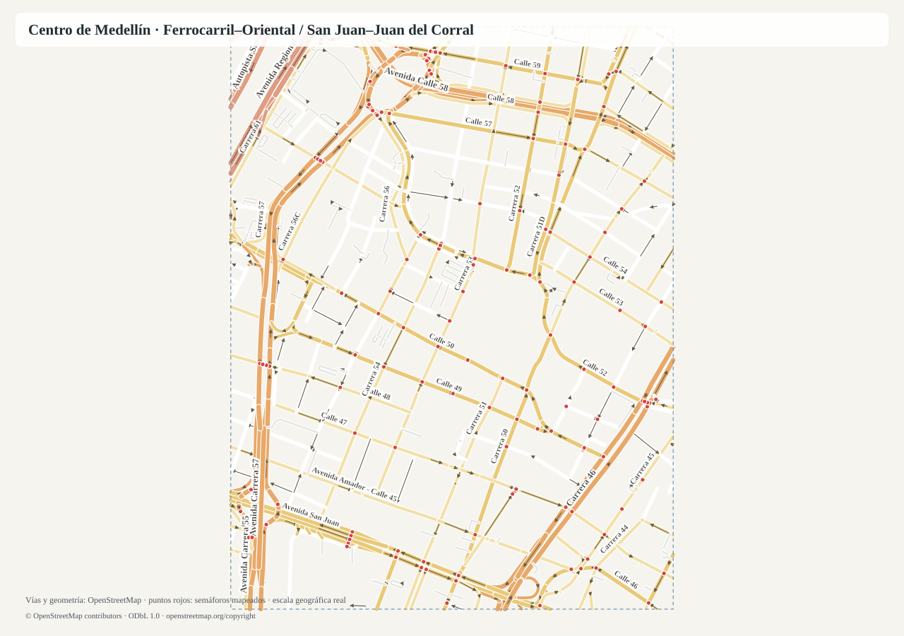

# Gemelo de ciudad: centro de Medellín (zona B reducida)

Estado: **fases 1 y 2 hechas**: red vial y demanda hipotética validadas con plano (PR #65) y el día completo corre en SUMO con indicadores (D66). Sin escena 3D ni enjambre todavía.
Pedido: Andy, 2026-10-19 (hilo «Gemelo digital de ciudad», ver `docs/registro/historico/proyecto/hilo-gemelo-de-ciudad.md`).
El plan completo para debatir está en el documento «Plan: gemelo digital de ciudad (centro de Medellín)» del proyecto; aquí va el resumen técnico.

## 1. Qué representa

Un pedazo del centro de Medellín, **aproximado e inventado**, para simular un día completo de tráfico con vehículos autónomos
(cada vehículo es un agente con origen, destino y prisa) y luego probar escenarios con Fractal: calles nuevas, glorietas,
otros tiempos de semáforo. Los datos son supuestos (`assumed: true`) hasta tener datos reales del SIMM.

Decisiones del autor (D65):
- Zona B del plan (centro entre la avenida del Ferrocarril, la Oriental, San Juan y Juan del Corral) **con la mitad de intersecciones**: 35 en vez de 60 a 80.
- Sin imágenes satelitales: esa línea se descartó (16:54 UTC).
- Escenario hipotético verosímil, no datos reales todavía.
- El enjambre de agentes va separado del gemelo (el gemelo aplica la física y los semáforos; cada agente decide).

## 2. Archivos

| Archivo | Qué tiene |
|---|---|
| `city-models/centro-medellin-v1/network.yaml` | 7 carreras x 5 calles con sentido, carriles, límite y separador; 20 cruces con semáforo y sus planes de tiempos por franja; tramos adicionales para escenarios |
| `city-models/centro-medellin-v1/demand.yaml` | 60.000 entradas al día, perfil de 24 h, 7 franjas con velocidad esperada y % de agentes con afán, mezcla de 7 tipos de vehículo, pico y placa, atractores |
| `city-models/centro-medellin-v1/layout.svg` | Plano generado (no se edita a mano) |
| `tools/city/network.py` | Valida la red y la demanda y dibuja el plano |
| `tools/city/tests/test_network.py` | Pruebas (tamaño, horas sobre capacidad, sentidos, ciclos, conectividad, calle nueva) |
| `tools/city/sumo_city.py` | Convierte red, semáforos y demanda a SUMO, corre el día y calcula los indicadores |
| `tools/city/tests/test_sumo_city.py` | Pruebas de la conversión y una corrida corta (necesitan `uv sync --group city`) |
| `city-models/centro-medellin-v1/resultados/linea-base.json` | Indicadores de la línea base (semilla 1); `build/` guarda los archivos de SUMO y no se versiona |

```bash
uv run python tools/city/network.py city-models/centro-medellin-v1   # valida, resume y escribe layout.svg
uv sync --group city                                                # instala SUMO (eclipse-sumo, licencia EPL 2.0)
uv run python tools/city/sumo_city.py city-models/centro-medellin-v1  # día completo en unos 4 min
uv run pytest -q tools/city/tests
```

## 3. La red

- Cuadrícula de 900 x 720 m: carreras cada 150 m (Ferrocarril, 55, 53, Bolívar, 50, 48, Oriental) y calles cada 180 m (San Juan, 46, Pichincha, Colombia, Juan del Corral).
- Avenidas de doble sentido con 3 carriles por sentido y separador (Ferrocarril, Oriental, San Juan); Bolívar, Colombia y Juan del Corral con 2 por sentido; el resto de sentido único alterno con 2 carriles.
- Cada calle sigue 100 m fuera de la zona hasta una **puerta**: 18 de entrada y 18 de salida. Las entradas se reparten por carriles.
- **20 semáforos**: todos los cruces de las tres avenidas y de Colombia. Los otros 15 cruces van con pare o prioridad.
- Planes de dos fases (carreras / calles) por franja: 60 s de madrugada, 120 s en los picos y 90 s el resto, con 3 s de amarillo y 2 s de todo rojo por fase. El validador exige que verdes + 10 s cierren el ciclo.
- Una calle nueva de un escenario se agrega en `extra_links` (desde, hasta, carriles, velocidad); el largo se calcula.



## 4. Demanda hipotética

Escalada a la mitad del escenario del plan porque la zona tiene la mitad de cruces: **60.000 entradas al día** y capacidad supuesta
de **4.250 por hora**. El pico es de 5.100 veh/h a las 7:00, y la zona queda sobre la capacidad a las 7, 17 y 18 h.

Mezcla: motos 30 %, carros 28 %, taxis 12 %, motos de domicilio 10 %, carga liviana 10 %, buses 6 %, carga pesada 4 %
(prohibida en los picos). Pico y placa saca el 20 % de los carros de 6 a 20 h. El 30 % de los viajes termina dentro de la zona,
en cuatro atractores (comercio, oficinas, parqueadero, hospital).

## 5. Lo que sigue (fases del plan)

1. ~~Red y datos~~ (esta entrega, con red aproximada a mano porque OpenStreetMap no es accesible desde el entorno de trabajo).
2. ~~Gemelo base en SUMO~~ (sección 6).
3. Vista 3D de la ciudad en el visor actual, reproduciendo la corrida, con el panel de curvas de 24 h.
4. Enjambre: los agentes en un proceso aparte con la interfaz estado → acción y los perfiles de prisa por hora.
5. Escenarios con Fractal y panel de monitoreo con los 15 indicadores y el criterio de éxito del plan.

Pendiente: calibrar la congestión (sección 6.3) y si habrá presupuesto para tráfico en vivo.

## 6. Motor de tráfico: SUMO (fase 2, D66)

Andy eligió SUMO (2026-10-19 23:23): libre (Eclipse Public License 2.0), con modelo de subcarriles para motos y una interfaz para controlar cada vehículo desde fuera, que es por donde entrará el enjambre.

### 6.1 Cómo se arma la corrida
- **Red:** cada cruce es un nodo (`traffic_light` si tiene semáforo, `priority` si no) y cada tramo dirigido un `edge` con sus carriles y límite; `netconvert` arma los giros. Sin giros en U.
- **Semáforos:** por cada semáforo y franja, un programa de dos fases (carreras, calles) con verde, 3 s de amarillo y 2 s de todo rojo; los giros a la izquierda ceden el paso. Un WAUT cambia de programa a la hora de cada franja.
- **Vehículos:** 7 tipos en dos variantes, tranquilo y con afán. El de afán va un 15 % más rápido, cambia de carril con más agresividad, se impacienta y re-enruta si hay atasco. Las motos usan el modelo de subcarriles (resolución lateral de 0,8 m, 0,5 m de separación lateral) y filtran entre carros.
- **Viajes:** la hora de salida sigue el perfil de 24 h; tipo según la mezcla de la hora (pico y placa, carga pesada fuera de los picos); entrada por puerta en proporción a sus carriles; 30 % a un atractor y 70 % a otra puerta; afán según la franja. Con la misma semilla salen los mismos viajes, para que Fractal compare escenarios contra la misma demanda.
- **JEV (fase 4):** decidirá en cada cruce qué salida tomar y cuánta prisa tiene cada agente; la conducción de cada paso sigue en SUMO. Las decisiones se guardarán con su estado para repetir corridas sin volver a consultar.

### 6.2 Línea base (semilla 1)

| Indicador | Valor |
|---|---|
| Viajes completados | 60.000 de 60.000 |
| Bloqueos (vehículos teletransportados tras 5 min detenidos) | 3 |
| Velocidad media | 27,6 km/h |
| Demora media por viaje | 63 s |
| Horas-vehículo de demora en el día | 1.050 |
| Hora más lenta | 7:00 (demora media 71 s) |
| Ruta crítica | entrada por la carrera 55 desde el sur hasta la salida de Colombia al occidente: índice 2,65 (amarillo) |
| Corredores en amarillo | Oriental 1,73, Ferrocarril 1,71, San Juan 1,60; el resto en verde |

La corrida del día completo tarda unos 4 minutos en el entorno de trabajo.

### 6.3 Lo que muestra y lo que falta calibrar
Con estos supuestos el centro **no colapsa**: la red aguanta los 5.100 vehículos de la hora pico a 25 km/h, mientras el escenario hipotético suponía 12 km/h y colapso a 4.250 por hora. Faltan en el modelo las cosas que hacen lento el centro real: buses y taxis parando en la vía, carga descargando en la calzada, peatones cruzando y carros estacionados. La calibración (siguiente paso) los agrega o sube la demanda hasta que la velocidad de cada franja se acerque a la del escenario; con datos del SIMM se calibrará contra lo medido.
