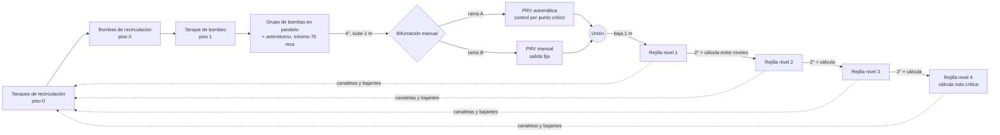

# Acueducto a escala (tercera planta de demostración) · diseño

Estado: diseño fusionado (PR #13, supuestos S1–S7 aceptados por defecto al fusionarlo), **solucionador hidráulico hecho** (PR #14, sección 5.1), los 4 tipos de equipo en la librería (PR #22 a #24) y **la planta en el motor de planta** (`industrial-models/water-network-scale-v1/`, sección 5.2, entrega 4). Falta la escena 3D del edificio (sección 9). Navier-Stokes queda para una fase posterior, pero el modelo se prepara desde ahora para recibirlo (sección 8).

Pedido original: Carlos Andrés Quiceño, 2026-10-17 00:20 UTC (hilo «Acueducto a escala», ver `docs/registro/historico/proyecto/hilo-acueducto-a-escala.md`).

## 1. Qué representa

Un banco de pruebas a escala, montado en un edificio, que reproduce el acueducto de una ciudad:

- **Bombeo** desde un tanque con dos bombas multietapa en paralelo, con la presión de descarga en **al menos 70 mca** (picos hasta 80).
- **Estación reguladora de presión** con dos ramas a elegir a mano: una válvula reductora con control automático y otra con control manual.
- **Red de distribución** de cuatro niveles. Cada nivel es una **rejilla** rectangular de válvulas que representan las casas de una comuna o barrio, más unas válvulas de **fuga** (pérdidas técnicas, fraudes, conexiones ilegales) pintadas de otro color.
- **Recirculación**: lo que sale por las válvulas cae a canaletas, baja a los tanques de recirculación y vuelve a subir a los tanques de bombeo.

El objetivo de control es el de una empresa de acueducto real: **bombear al menos 70 mca y que la estación reguladora baje la presión hasta dejar la válvula más crítica de la red en 15 mca con 3 % de margen (15,45 mca)**, no solo a su propia salida. La consigna de la estación resulta de eso (18,09 mca, D29). Alertas en la casa crítica: 20, 18 y 15 mca. Con eso la demo muestra la gestión de presión: menos presión de sobra, menos fugas.

## 2. Distribución en el edificio

Pisos confirmados por el autor (2026-10-17): piso cero con la recirculación; piso 1 con las bombas Grundfos, la reguladora y el nivel 1 de la rejilla a ras de piso; de piso 1 a piso 2 hay unos 2,5 m. Los niveles de la rejilla van cada 1,20 m por la columna: nivel 2 a 1,20 m, nivel 3 a 2,40 m y nivel 4 a 3,60 m del nivel 1.

| Piso | Qué hay |
|---|---|
| 0 | Tanques de recirculación (llegan las bajantes de las canaletas) y bombas de recirculación (centrífugas normales), que llevan el agua al tanque de bombeo |
| 1 | Tanque de bombeo, grupo de bombas multietapa en paralelo con antirretorno, tramo que sube 1 m, estación reguladora elevada, bajada de 1 m y **nivel 1** de la rejilla a ras de piso con su canaleta |
| 2 y más | Niveles 2, 3 y 4 de la rejilla en la columna, cada uno 1,20 m más arriba que el anterior (**nivel 4** a 3,60 m sobre el nivel 1) |



## 3. Equipos

| Id en el plano | Qué es | Tipo de librería (nuevo salvo indicación) | Cantidad |
|---|---|---|---|
| `tank-recirc-01..02` | Tanques de recirculación, cilindros de 1,30 m de diámetro × 1,70 m (≈ 2,26 m³ c/u, ≈ 4,5 m³ en total), piso 0 | `vessel` (preset `water-1000l`, a ajustar al volumen) | 2 |
| `pumpset-recirc-01` | 2 bombas centrífugas normales (1 trabaja, 1 reserva), 15 m³/h a 10 mca c/u, arranque por nivel, piso 0 | `booster-pump-set` (preset `recirculation-2x15m3h`) | 1 |
| `tank-supply-01` | Tanque de bombeo de las bombas Grundfos, 1,50 m × 2,20 m (≈ 3,9 m³), piso 1, alimentado por recirculación | `vessel` (preset a ajustar al volumen) | 1 |
| `pumpset-main-01` | 2 bombas multietapa verticales en paralelo (las dos trabajan, sin reserva), 13 m³/h a 80 m c/u, descarga mínima de 70 mca a la entrada de la reguladora; variador, antirretorno por bomba, colector de 4", piso 1 | `booster-pump-set` (preset `multistage-2x13m3h-80m`) | 1 |
| `prs-01` | Estación reguladora: bifurcación con válvulas de corte manuales, rama A con PRV automática, rama B con PRV manual de piloto, unión | `pressure-reducing-station` | 1 |
| `grid-01..04` | Rejilla de un nivel: cabezal y ramales de 2", 16 válvulas de consumo (4 × 4), 2 válvulas de fuga (rojas), cada válvula numerada, canaletas casi a ras de la salida de las válvulas | `distribution-grid` | 4 |
| `valve-between-12/23/34` | Válvula de regulación entre niveles, apertura fija manual (automatizable después) | `regulating-valve` | 3 |

Equipos de 5 tipos: `vessel` ya existe y se reutiliza; los otros cuatro se crean con `docs/equipment-authoring.md`. Las tuberías no son equipos: son los `flows` del plano con diámetro y longitud (sección 5).

Nombres de marca: el autor describió las bombas como Grundfos. La regla del repositorio es no usar marcas ni nombres de empresas reales (`AGENTS.md`), así que el tipo es una **bomba centrífuga multietapa vertical** genérica con curva de ese estilo. Si el autor quiere el nombre comercial, es una decisión aparte.

### Rejilla de un nivel (`distribution-grid`)

Supuesto de distribución (el autor dejó libre la forma): rectángulo de 2,0 × 2,0 m. Un cabezal de 2" a lo largo del frente con 4 nodos cada 0,5 m; de cada nodo sale un ramal de 2" hacia el fondo con 5 posiciones cada 0,5 m, donde van las 4 válvulas de consumo y, en los ramales 2 y 4, la fuga (corregido 2026-10-17). Las dos válvulas de fuga cuelgan de los ramales 2 y 4, en la posición que indique el parámetro (1, 3 o 5), y descargan a la canaleta igual que las casas. La red se cierra con caminos entre ramales vecinos en los extremos y en la tercera posición (corregido 2026-10-17, pedido del autor). La válvula más crítica es la última del último ramal (la más lejana de la entrada) del nivel 4.

```
entrada (montante 2")
   │
   ●──────●──────●──────●   cabezal 2"
   │      │      │      │
   ○      ○      ○      ○   ← posición 1 (casa, o fuga F en los ramales 2 y 4)
   ○      ○      ○      ○   ← posición 2
   ○ ─────○      ○ ─────○   ← posición 3 (caminos entre ramales 1–2 y 3–4)
   ○      ○      ○      ◎   ← posición 4 (◎ = válvula más crítica, c44)
   ○ ─────○ ─────○ ─────○   ← posición 5 (caminos en los extremos)
 ─────────────── canaleta ───────────────
```

Las fugas (F, rojas) van en los ramales 2 y 4 en la posición 1, 3 o 5, según el parámetro; el diagrama dibuja la posición 1 por claridad.

Las fugas (F, rojas) van en los ramales 2 y 4, en la posición 1, 3 o 5 según el parámetro: el diagrama muestra las de la posición 5 de la configuración por defecto.

Cada válvula, de consumo o de fuga, publica **apertura (%)**, **caudal (L/min)** y **presión aguas arriba (mca)**, y acepta el comando `set_opening` (0–100 %, por válvula o por grupo). La rejilla publica además los totales del nivel: consumo, fugas, presión mínima y cuál válvula la tiene.

## 4. Predimensionamiento

Calculado con `tools/hydraulics/predimensionamiento.py` (Darcy-Weisbach, PVC; reproducible con `python tools/hydraulics/predimensionamiento.py`). Supuestos de las válvulas, todos `assumed`:

| Elemento | Valor de diseño |
|---|---|
| Válvula de consumo (aguja de ½") | Kv 0,12 m³/h al 100 % (≈ 2,9 L/min a 20 mca) |
| Válvula de fuga (orificio) | Kv 0,12 m³/h, exponente de presión 0,5 |
| Válvula entre niveles (bola de 2", apertura fija) | Kv 20 m³/h |
| Tubería hasta la estación y hasta el nivel 1 | 4" (DI 102 mm) |
| Red (montantes, cabezales, ramales) | 2" (DI 52,5 mm) |

Resultado con todas las válvulas de consumo abiertas (día) y la PRV automática:

| Punto | Presión | Caudal |
|---|---|---|
| Salida del grupo de bombas | 80 mca (consigna) | 13,0 m³/h (3,6 L/s) |
| Llegada a la estación reguladora (1 m más arriba) | 79,0 mca | velocidad en 4": 0,44 m/s |
| Salida de la PRV | 26,7 mca (disipa 52 mca) | |
| Entrada nivel 1 | 27,4 mca | 3,5 m³/h (consumo 3,15, fugas 0,39); velocidad en el montante de 2": 1,67 m/s |
| Entrada nivel 2 | 23,7 mca | 3,3 m³/h |
| Entrada nivel 3 | 21,5 mca | 3,1 m³/h |
| Entrada nivel 4 / válvula más crítica | 20,0 / **20,0 mca** | 3,0 m³/h |

De noche (válvulas de consumo al 30 %):

| Control | Salida PRV | Válvula más crítica | Fugas totales |
|---|---|---|---|
| PRV automática (punto crítico) | 23,2 mca | 20,0 mca | 1,42 m³/h |
| PRV manual (queda con la salida del día) | 26,7 mca | 23,4 mca | 1,50 m³/h |

Con fugas tipo orificio (exponente 0,5) la PRV automática ahorra ≈ 5 % de fugas de noche; con un exponente de 1,15, típico de redes de PVC con fisuras, el ahorro sube a ≈ 15 %. El exponente queda como parámetro de las válvulas de fuga para mostrar ese efecto.

**Actualización 2026-10-17 (confirmada por el autor):** las presiones de esta sección son el predimensionamiento original, con 80 mca de bombeo y 20 mca en la válvula crítica. La versión vigente es: bombas con mínimo 70 mca, consigna de la estación de 18,09 mca y válvula crítica en 15,45 mca (D29). Los valores del banco están en la sección 5.1 y en `industrial-models/water-network-scale-v1/network.py`.

Bombas: dos multietapa de 13 m³/h a 80 m, sin reserva (el autor fijó 2 bombas). Cada una sola cubre el día (13 m³/h a 80 mca, con el variador al 99,7 %), para que la presión no caiga bajo 75 mca si una falla (pedido del autor, 2026-10-17); con las dos, el variador baja al 92 %. Recirculación: la elevación desde los tanques del piso 2 a los del piso 3 es ≈ 4,5 m; 10 mca con pérdidas, 15 m³/h para reponer más rápido de lo que se consume. Volumen: el tanque de bombeo de ≈ 3,9 m³ da ≈ 17 min de autonomía a 13,5 m³/h, sin reposición.

## 5. Modelo de simulación

### Por qué hace falta un solucionador hidráulico

El motor de planta actual (`docs/plant-engine.md`) pasa magnitudes de una salida a una entrada con un paso de retraso y sin reparto. Una red de agua no funciona así: el caudal de cada una de las 72 válvulas depende de la presión en su nodo, y esa presión depende de lo que consumen todas las demás. Hay que resolver la red completa en cada paso.

**Propuesta:** un dominio hidráulico en el motor de planta.

1. **Primitiva** `twin_runtime/primitives/hydraulics.py` (hecha, ver 5.1): solucionador de redes a presión por el método del gradiente global (Todini-Pilati, el mismo de EPANET), en Python puro. Elementos: tubo (Darcy-Weisbach), válvula con Kv y característica de apertura, bomba con curva H-Q y velocidad, antirretorno, PRV (consigna de presión aguas abajo), descarga a la atmósfera con exponente (consumo y fugas) y nivel fijo (tanque). Resuelve el estado cuasiestacionario en cada paso.
2. **Puertos hidráulicos** en los contratos: `kind: hydraulic` con `link: { network: water }`. Cada tipo de equipo declara los elementos que aporta (la rejilla aporta sus tramos y sus 18 válvulas; la estación sus dos ramas). Los `flows` del plano con `piped: true` aportan los tubos, con `diameter_in`, `length_m` y una ruta con elevación (campo nuevo `route`, puntos `[x, y, z]`), que también usa la escena para dibujar la subida y la bajada de 1 m.
3. **Paso del motor:** antes de avanzar los equipos, el motor junta todos los elementos de la red `water`, la resuelve y entrega a cada equipo su presión y caudal (`pressure_mca`, `flow_m3_h`). Los equipos con dinámica propia (nivel de tanques, variador de las bombas, PID de la PRV automática) avanzan con esos valores y su nuevo estado entra en la solución del paso siguiente. Se conserva la regla del paso de retraso entre el control y la red.
4. **Enlaces de servicio que no son de presión** (recirculación por gravedad desde las canaletas) siguen siendo enlaces normales del motor con `flow_kg_h`, con un retardo de bajada.

Alternativa descartada: una sola «planta-equipo» que resuelva todo por dentro. Es más rápida de escribir, pero no deja seleccionar ni ajustar cada equipo en la escena ni reutilizar los tipos en otra red.

### 5.1 Solucionador hidráulico (hecho)

```python
from twin_runtime.primitives import HydraulicNetwork

net = HydraulicNetwork()
net.add_fixed_head("supply", 80.0)                       # tanque o descarga de bombas: cabeza fija (m)
net.add_node("a", elevation_m=0.0)
net.add_node("b", elevation_m=0.0)
net.add_pipe("main", "supply", "a", length_m=10, diameter_m=0.1022, minor_k=3.0)
net.add_prv("prv", "a", "b", setting_mca=20.0, kv_m3h=60)
net.add_emitter("house", "b", kv_m3h=0.12, opening=1.0)  # descarga a la atmósfera
res = net.solve()          # res.flows_m3h, res.pressures_mca, res.heads_m, res.status, res.velocity_m_s
net.set("house", opening=0.3); net.set("prv", setting_mca=22.0); net.set_head("supply", 78.0)
```

- **Elementos:** `add_pipe`, `add_valve` (lineal o de igual porcentaje), `add_check_valve`, `add_pump` (curva por H a caudal cero y punto de diseño; `speed` relativa, H ∝ s²), `add_emitter` (exponente β), `add_prv`, `add_fixed_head`, `add_node` (con `demand_m3h`).
- **Estados** como EPANET: bombas, antirretornos y descargas no dejan pasar caudal al revés; la PRV queda `active` (fija su presión de salida), `open` (no le alcanza la presión de entrada) o `closed` (aguas abajo hay más que su consigna).
- **Arranque en caliente:** cada `solve()` parte de la solución anterior. La red de diseño (163 nodos, 162 elementos) converge en 6 iteraciones en frío y en 3 a 5 tras un cambio, en milisegundos, así que se puede resolver en cada paso de 1 s.
- **Pruebas** (`packages/twin-runtime/tests/test_hydraulics.py`): casos calculados a mano (descarga por Kv, válvulas en serie y en paralelo, bomba contra la curva del sistema, bombas en paralelo, velocidad, PRV activa, abierta y cerrada, antirretorno, Hagen-Poiseuille, Darcy-Weisbach) y la red de diseño completa, que reproduce la sección 4 dentro del 2 %: 13,0 m³/h y 20,0 mca en la válvula crítica de día, 23,4 mca de noche con la PRV fija. Las tolerancias de las pruebas son relativas.
- **Entrega 4:** el motor de planta ya arma la red desde los contratos (sección 5.2).

### 5.2 La planta en el motor (entrega 4, hecha)

`industrial-models/water-network-scale-v1/plant.yaml` (edificio, pisos, rutas de los tubos) y `simulation.yaml` (equipos, enlaces y escenarios de prueba). El dominio hidráulico del motor se describe en `docs/plant-engine.md` (sección 2b): una sola red con los elementos de los 13 equipos y los tubos del plano, resuelta en cada paso.

- **Pisos (supuesto S2):** cada 2,5 m. Piso 0: tanques de retorno (Ø 1,3 × 1,7 m) y bombas de recirculación, debajo de la columna. Piso 1 (cota 2,5): tanque de bombeo (Ø 1,5 × 2,2 m), las dos bombas multietapa, la subida de 1 m, la estación a 3,5 m y la bajada al nivel 1 de la rejilla a ras del piso. Columna: niveles a 2,5, 3,7, 4,9 y 6,1 m.
- **Columna en serie** como la describió el autor: nivel 1 → válvula entre niveles → nivel 2 → … → nivel 4. El banco anterior de `network.py` tenía una columna directa a cada nivel; ahora `network.py` arma la misma red que el motor, con los tubos del plano, y es el cálculo de referencia de los escenarios.
- **Consignas:** bombas a 72,1 mca en su sensor de descarga (70 + 3 %, supuesto: PLC cerrado), las dos de trabajo siempre (`min_running: 2`); estación en la rama automática con la casa crítica en 15,45 mca. Con la serie, de día la estación queda en **20,94 mca** (no 18,09: esa cifra era de la columna directa) y la rama manual se deja en esa salida (decisión en curso con el autor). De noche (casas al 30 %) baja a 18,46 mca.
- **Resultados (banco y motor coinciden en ± 0,5 %):** de día 11,53 m³/h, 71,1 mca a la entrada de la reguladora y fugas 1,28 m³/h; la casa crítica es c44 del nivel 4. De noche, la rama automática ahorra 6,4 % de fugas frente a la manual con la salida del día (1,253 contra 1,338 m³/h).
- **Disparo de una bomba:** la otra salta con la rampa del variador a la velocidad que sostiene la misma altura (anticipación, supuesto del control); la presión baja a 68,9 mca un segundo, dentro de la regla de D29 (piso de 65 mca, hasta 5 s).
- **Recirculación:** las bajantes de los niveles 1 y 2 van al tanque de retorno 1 y las de 3 y 4 al 2; las bombas de recirculación arrancan con los tanques de retorno al 60 % y paran con el de bombeo al 90 % (≈ 20 min por ciclo). El agua se conserva (prueba `test_water_is_conserved_through_the_recirculation`).

### Control

| Lazo | Medición | Actúa sobre | Consigna y tolerancia |
|---|---|---|---|
| Presión de bombeo | Presión en el sensor de descarga de Grundfos, antes de la reguladora | Velocidad de las bombas; entra la 2.ª bomba si la 1.ª pasa del 95 % de velocidad 10 s, sale si bajan del 60 % | Mínimo 70 mca, picos hasta 80 mca; bajón de hasta 5 s con piso de 65 mca (D29). El PLC de Grundfos es cerrado: sus parámetros son supuestos |
| PRV automática (rama A) | Presión en la válvula más crítica (telemetría del nivel 4) | Consigna de salida de la PRV, PID con límites | 18,09 mca de consigna de la estación; casa crítica en 15,45 mca (3 % sobre 15 mca, D29) |
| PRV manual (rama B) | Su propia salida (piloto de resorte) | — | Salida fija ajustable, por defecto 26,7 mca |
| Bifurcación | — | Válvulas de corte manuales: comando `select_branch` (`auto`, `manual`), con cierre y apertura escalonados para no cortar el suministro | — |
| Recirculación | Nivel de tanques de recirculación y de bombeo | Arranque y paro de la bomba de recirculación | Arranca al 60 %, para al 20 % del tanque de recirculación; no arranca si el de bombeo pasa del 90 % |

Las tolerancias van en **porcentaje de la consigna** (regla D07 del registro), no en mca fijos.

### KPIs de la planta

- Agua no contabilizada (%) = fugas ÷ volumen bombeado.
- Presión en la válvula más crítica y en la salida de la PRV.
- Potencia disipada en la PRV (kW) y energía de bombeo (kWh/m³).
- Consumo y fugas por nivel (comuna).

## 6. Escenarios previstos

Las expectativas se calculan a mano con la sección 4 antes de escribir el escenario.

| Escenario | Qué muestra |
|---|---|
| `nominal` | Día: todas las casas abiertas, rama automática. Al menos 70 mca en bombas, 15,45 mca en la válvula crítica, 13 m³/h |
| `night-pressure` | Demanda de 24 h (curva diaria); la rama automática baja la salida de la PRV de noche y las fugas bajan |
| `manual-branch` | El operador pasa a la rama manual: la presión crítica sube de noche y las fugas aumentan; comparación de KPIs |
| `pump-trip` | Falla de una bomba principal: sin reserva, la otra acelera y sola sostiene 13 m³/h a 80 mca (un bache de ≈ 1 s mientras acelera, sin alarma de baja presión) y el antirretorno evita el retroceso por la bomba parada |
| `leak-burst` | Una válvula de fuga del nivel 2 se abre del todo (fraude o rotura): sube el agua no contabilizada, baja la presión del nivel y la PRV automática compensa |
| `between-valve` | Se cierra a la mitad la válvula entre niveles 2 y 3: los niveles de arriba pierden presión aunque la estación esté bien |

## 7. Escena 3D

Reutiliza la escena de planta (`docs/plant-scene.md`): un edificio de 4 pisos con losas transparentes, cada equipo con su geometría y las tuberías con su ruta en 3D (la subida y bajada de 1 m se ven). Colores: válvulas de consumo en azul, de fuga en rojo, tubería de 4" y de 2" diferenciadas por grosor. Cada válvula muestra su caudal (chorro proporcional a su caudal hacia la canaleta) y un indicador de presión; al seleccionarla se ven apertura, caudal y presión y se puede cambiar su apertura. Cámaras: general, cuarto de bombas, estación reguladora y una por nivel de la rejilla. Captura de verificación en cada PR con cambio visual.

## 8. Preparado para Navier-Stokes

La fase 1 es un modelo 1D (red). Para acoplar después CFD (Navier-Stokes) sin rehacerlo:

- **Geometría exportable:** cada tubo guarda su ruta 3D, diámetro interior, rugosidad y accesorios; cada equipo hidráulico declara sus bocas (posición, diámetro, sentido). Un exportador generará la geometría (eje y superficies) para mallar.
- **Condiciones de borde por componente:** el solucionador 1D publica, por cada boca, caudal, presión y velocidad media en cada paso. Son las condiciones de entrada y salida de una simulación CFD de un componente (la estación reguladora, una tee del cabezal, la válvula crítica).
- **Acoplamiento por etapas:** primero CFD fuera de línea de un componente con las condiciones del 1D (acople en un sentido); después reemplazar el coeficiente de pérdida de ese componente en la red por el que da la CFD (en dos sentidos). Para transitorios (golpe de ariete al disparar una bomba o cerrar el antirretorno) una etapa intermedia con el método de las características sobre la misma red.
- **Propiedades del fluido** como parámetros de la red (densidad, viscosidad, temperatura), no constantes en el código.

## 9. Entregas (PRs pequeños)

1. **Este diseño** y el script de predimensionamiento (sin código de producción). Hecho: PR #13.
2. **Solucionador hidráulico** en `twin-runtime`, con pruebas contra casos calculados a mano (tubo simple, dos ramas en paralelo, bomba contra curva del sistema, PRV). Hecho: PR #14.
3. **Tipos de equipo** `booster-pump-set`, `pressure-reducing-station`, `regulating-valve` y `distribution-grid` (contrato, comportamiento, geometría, presets, escenarios) y el preset `water-1000l` de `vessel`. Captura de la galería de cada uno. Hecho: PR #22 y #23 (`booster-pump-set`, `regulating-valve`, `water-1000l`) y PR #24 (`pressure-reducing-station`, `distribution-grid`); PR #25 agranda las bombas principales a 13 m³/h para que una sola sostenga la presión y numera las válvulas de la rejilla.
4. **Planta** `industrial-models/water-network-scale-v1/` (`plant.yaml` con pisos y rutas, `simulation.yaml`) y dominio hidráulico del motor, con los escenarios de la sección 6. Hecho (sección 5.2); `night-pressure` usa un cambio de apertura al 30 % en vez de la curva de 24 h, que se deja para los escenarios que cree el usuario.
5. **Escena 3D** del edificio, con captura y API de simulación.

## 10. Supuestos para confirmar

| # | Supuesto | Por qué importa |
|---|---|---|
| S1 | Rejilla de 4 × 4 válvulas de consumo y 2 de fuga por nivel, 2,0 × 2,0 m | Número de casas por comuna y tamaño de la escena |
| S2 | Piso 1 a piso 2 de unos 2,5 m; niveles de la rejilla cada 1,20 m; nivel 1 a ras de piso (confirmado) | Presiones estáticas de cada nivel |
| S3 | Kv de las válvulas (sección 4) | Caudal total y tamaño de las bombas |
| S4 | 2 bombas principales, las dos de trabajo (el autor corrigió el supuesto de 2 + 1 el 2026-10-17) y 2 de recirculación (1 + 1) | Lógica de alternancia y escenario de falla |
| S5 | La PRV automática mide la presión en la válvula crítica por telemetría | Es lo que permite el objetivo de 20 mca en el punto crítico |
| S6 | Bombas genéricas, sin marca | Regla del repositorio |
| S7 | Tanque de bombeo de ≈ 3,9 m³ y dos tanques de recirculación de ≈ 4,5 m³ en total (confirmado) | Autonomía y dinámica de niveles |
